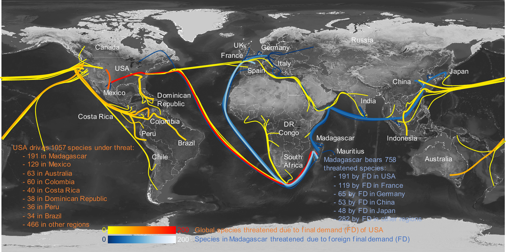

## A three-decade-long analysis shows rising threatened species and responsibility gaps in global supply chains

Ling Zhang, **Quanliang Ye**, Ali Kharrazi, Qingxu Huang, Jiansheng Wu, Brian Fath

*Proc. Natl. Acad. Sci. U.S.A.* **123** (37) e2604868123, [10.1073/pnas.2604868123](https://doi.org/10.1073/pnas.2604868123)

**Abstract** Rapid globalization and its accordant supply chains accelerates biodiversity loss. Yet timely assessments of biodiversity status and trends remain insufficient, limiting effective conservation actions in response to supply chain dynamics. Here, we provide a three-decade-long analysis of status and trends of three main biodiversity threats and 21,207 threatened species along production, trade, and final consumption between 185 countries. Results show escalating trends and newly identified threat-species-country-activity networks in biodiversity impacts across global supply chains. We identify changes in people’s consumption structure and species intensity of economic activities as the main drivers of this escalation. International trade contributes a large and increasing proportion of total threatened species in most countries, especially for imports to the United States, Japan, and exports from Madagascar, Papua New Guinea. In particular, the bilateral trade between the United States and Madagascar causes the largest number of threatened species (191 ± 17) among all bilateral trade flows worldwide. Furthermore, a unique pattern is revealed from our biodiversity assessment, unlike other environmental pressures such as carbon footprints, that species threatened by per-capita final demand in Latin America, and Caribbean (a developing region) is at least 38% higher than those in developed regions and three times the global average. A timely understanding of shared responsibilities of producer- and consumer-nations for biodiversity threats and status offers a scientific basis for fair and accountable biodiversity governance.

|
|:--|
|Figure. International flow map of threatened species.|